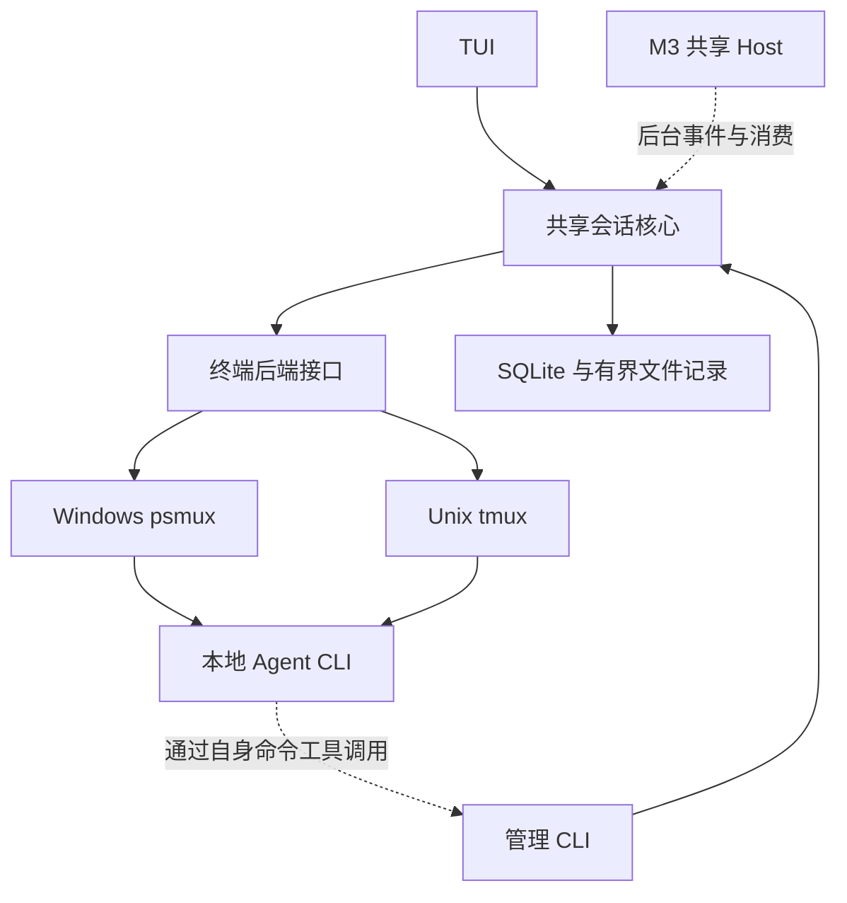

# 架构说明

状态：架构方向已接受，首批 M0 迁入切片已有实现；完整存储、通信、通知与 Windows 验收待做。更新日期：2026-11-21。

本文件落实 [TECH_STACK.md](TECH_STACK.md) 与 [ADR](adr/README.md) 中的决定：Go 模块化单体、Charm v2、Agent Deck UI 选择性复用、Windows psmux 后台。产品要求见 [PRODUCT_PLAN.md](PRODUCT_PLAN.md)，实现状态与证据见 [FEATURE_LEDGER.md](FEATURE_LEDGER.md)。已接受的方向仍需通过 M0 Windows 与资源验证。

## 1. 分层与责任



| 模块 | 职责 |
| --- | --- |
| TUI | 简约列表、只读预览、搜索、按需表单、交互焦点、投递状态与统一待处理入口 |
| 共享会话核心 | 稳定身份、Run 生命周期、能力声明、消息/待处理事项规则和后端协调；共享代码，不单独部署为服务 |
| 终端后端接口 | 统一创建、接入、输入、resize、捕获输出、停止与退出事件 |
| Windows 后台 | psmux 正式版持有终端和子进程；不重复创建自有 ConPTY 宿主 |
| 存储 | TOML 配置；SQLite 元数据、队列与回执；有上限的输出文件及内存缓存 |
| M3 共享 Host | 一个共享轻量进程负责后台队列消费、持续事件、提醒与投递仲裁；按已启用能力运行，不为提醒再增加每会话后台 |
| Agent 适配器 | 可选的 ready/busy、人工介入事件、提交、取消、原生历史与 resume 能力 |
| 平台通知出口 | Windows 本地通知及可选 BEL 提醒；与事件状态和终端输入解耦，具体 Go 接入待验证 |
| 管理 CLI | 让用户和具备命令执行工具的 agent 操作已托管会话 |

TUI 的按键处理与绘制不应直接散落 tmux 或 Windows 进程调用。复用上游 UI 时，先识别并抽取这类边界。图中是职责关系，不表示每个方框都是常驻进程。

M0–M2 由按需运行的 TUI/CLI 调用共享核心，psmux/tmux 承担后台终端托管。M3 为关闭界面后的自动投递引入共享 Host，并按 ADR-0006 复用它持续接收人工介入事件和发送提醒；管理命令可按需执行，无消费者时落盘队列等待，也不承诺持续监测。具体 IPC、单实例和恢复机制在 M3 实施前固定。

### 默认界面与终端交接

管理状态仅显示会话列表、当前只读预览和简短提示。新建、搜索、发送和设置按需打开。进入会话后暂停管理界面并运行后台 attach 客户端；此时管理器侧栏和 Tab 隐藏，终端输入交给原 CLI。分离后恢复管理界面。

被动预览不持续修改正在 attach 的终端尺寸。常驻侧栏内嵌完整可交互终端、独立 VT 引擎均后置。旧 [v0.1 图稿](UI_DESIGN.md)保留为未采纳探索，不规定当前界面的布局或快捷键。

M2 的人工介入事件接收与绘制生命周期分离：进入 attach 时管理画面隐藏，但仍运行的管理器应继续处理可靠事件。提醒通过独立平台出口，不与子终端争写 stdout、不抢输入、不自动切换；系统通知被用户明确激活后，仅请求导航，接入前仍需核对 Session/Run/事项身份与当前输入交接。若所选 TUI 终端交接方式无法保持接收，必须修正或明确降级，不能据 GUI 标记存在就宣称 attach 中可提醒。

## 2. CLI-first 启动描述

用户可以填写一条启动命令。内部应保存明确的可执行入口、参数、工作目录与环境，不把任意字符串直接拼进多层 shell。

以下为拟议配置示例，不是当前可执行的配置规范：

```toml
[agents.local]
name = "Local Agent"
command = "java"
args = ["-jar", "D:/agents/my-agent.jar"]
cwd = "D:/projects/demo"
adapter = "generic-terminal"
```

Windows `.exe`、脚本入口、命令别名、PowerShell 命令和需要 shell 语法的命令要明确区分。复杂管道或脚本可使用显式 shell 启动模式，具体规则由原型验证。

agent 本身必须能在目标环境运行。管理器不自动把 Linux-only 程序转换成 Windows 程序。

## 3. 身份与持久化

- `profile_id`：启动配置身份。
- `session_id`：稳定会话身份，跨重命名、排序和 Run 保持。
- `run_id`：一次启动及进程树的身份。
- `view_id`：界面视图身份，不作为消息寻址依据。
- 消息记录包含 `message_id`、可选 `reply_to`、发送幂等键，以及目标会话和入队时的目标 Run。
- `agent_conversation_id`：可选，由 agent 自身提供，不能用 session_id 冒充。
- 人工介入事项另有稳定请求身份及事件身份/顺序依据，绑定 `session_id` 和 `run_id`；不使用 Tab 下标、标题或通知文本作唯一键。字段与协议名由 ADR-0006 的实施合同固定。

TOML 保存配置，SQLite 保存会话、运行与消息状态，长期输出使用轮转文件，当前预览使用有界内存缓存。具体驱动、schema、事务和限额尚未固定。保存终端记录不会保存 agent 内存或恢复活进程。

输出记录需区分：原始终端字节流、解析后的屏幕/滚动记录、可选结构化对话消息。原始全屏 TUI 重绘日志不能直接当作逐条聊天记录。

终端后台继续运行不等于产品日志始终连续采集。无自有消费者时，可读取的历史取决于后端已经保存的范围；后端日志能力需要另行验证。丢失、轮转或未采集的区间显式报告，不声称持有完整历史。

## 4. 终端与生命周期

ConPTY 是 Windows 的终端托管机制，宿主需要持续处理输入输出、VT 序列、终端尺寸和相关生命周期。本项目通过 psmux 使用这层能力。参考 [Microsoft Pseudoconsoles](https://learn.microsoft.com/en-us/windows/console/pseudoconsoles) 与 [创建会话说明](https://learn.microsoft.com/en-us/windows/console/creating-a-pseudoconsole-session)。

需要在 TUI 退出后继续运行时，由 psmux/tmux 持有终端与通信通道，继续处理终端输出；不能仅记录 PID。TUI 断开不应触发终端关闭。具体关闭行为见 [ClosePseudoConsole](https://learn.microsoft.com/en-us/windows/console/closepseudoconsole)。

psmux v3.4.0 正式版是 Windows 首轮验证目标，按一个产品 Session 对应一个后端 session，所有 server 和辅助进程都计入资源成本。使用产品私有配置关闭非必要预热；共享 server 开发分支不进入首版能力承诺。版本和边界见 [ADR-0002](adr/0002-terminal-backends-and-attach.md)。

后端 session/pane 存在、shell 存活和 agent 存活分别判断。无法取得 agent 级证据时显示“终端运行中 / agent 状态未知”，不从后台进程存在推定 agent 正在工作。

分别实现或声明：

1. 恢复上次界面布局。
2. 接回仍存活的 Run。
3. 启动新的 Run。
4. 通过已验证适配恢复 agent 原生对话。

电脑重启后不能接回原来的活进程。是否续聊和如何处理未完成工作需由 agent 能力与用户操作决定。

## 5. 能力声明与状态来源

接入声明 `terminal_io`、`read_output`、`submit_prompt`、`ready_signal`、`cancel_turn`、`structured_history`、`resume` 等实际具备的能力；能力名称和 API schema 在实现时固定。

进程状态与工作状态分别记录：

- 进程：starting / alive / exited / failed。
- 工作：unknown / ready / busy / approval 等，仅在存在依据时使用。
- 状态来源：进程事件、协议事件、hook、人工选择或启发式判断。

“一段时间没有输出”只是一项观察，不能单独证明空闲或完成。对未知 CLI，基础终端读写仍可用，增强能力按实际支持降级。

### 人工介入与提醒

按 [ADR-0006](adr/0006-human-attention-and-notifications.md) 独立记录 AttentionItem，至少区分事项生命周期、已查看/稍后提醒、观测新鲜度和通知出口结果。可信 hook/适配事件可形成明确待批准、待回答或待检查；终端文本匹配只形成疑似提示，不能自动升级 ready、批准或消息完成。

请求的处理证据必须对应原 Run 与具体事项。点击通知、查看会话、关闭横幅都不解决交互请求；断连保留未知，真实退出使该 Run 的旧审批/问答失效，异常退出检查记录仍可被查看并显式标记已检查。人工检查与 agent 解决分别记录；重复和乱序事件不能复活旧事项，同文的独立请求不能被合并。

应用内待处理记录与系统通知分开持久化/诊断。桌面通知、声音与完成通知默认关闭；启用后按事件变化和已固定策略发送，系统接受不表示人已读。OS 调用与本地存储之间的崩溃窗口可能产生不确定通知结果，不能承诺系统横幅端到端 exactly-once；恢复不丢已确认事项，不盲目反复弹出，也绝不重放批准输入。已观测到的通知故障、消费者空档保留可见状态；系统未暴露横幅展示或免打扰结果时保持展示未知，不以测试观察器知识代替产品证据。

UI 退出后的持续提醒需要已运行的共享 Host 或单独验证并声明的 hook 路径。M3 默认复用同一个 Host，不因 psmux 仍活着而推定监测还在运行。状态事件和记录保留必须有界；精确接口、限额、延迟口径与 Windows 激活路径见 [待决合同](testing/BUDGETS_AND_DECISIONS.md)。

## 6. 跨会话通信

### 读取

通过 session_id 寻址，返回来源、run_id、时间、输出游标或范围与内容。UI 预览、转交给另一 agent 的内容、模型实际上下文分别处理。转交时保存提交时的快照正文，不只保存来源标签。默认读取有限范围，避免整段历史无界增长。

### 发送

消息状态包括：queued、input_written、accepted、completed、failed、cancelled、unknown。只有对应证据存在时才更新状态，不要求所有适配器都能到达 accepted 或 completed。

队列持久化在 SQLite。自动投递要求可靠的 ready 信号与运行中的消费者；没有此能力的接入可保留待投递消息，并提供明确的输入操作。M3 的共享 Host 使后台自动消费能够独立于 TUI 运行；这项功能在实现并验证前不标为完成。粘贴与粘贴后提交是不同动作，具体提交方式由配置或适配器定义。

消息记录目标 session_id 及入队时的 target_run_id。目标 Run 退出或被替换后，未投递消息暂停并显示原因，不自动进入新 Run 的上下文；入队时没有活跃 Run 的消息也保持待投递，重新指定目标 Run 作为明确操作处理。

同一 session 的用户键盘输入、自动投递和终端协议回复需要有序协调，避免内容交错。所有管理入口共享跨进程的目标校验与串行投递规则；仅靠单个 TUI 的内存锁不够。用户正在 attach 时默认暂缓自动投递，直到明确交接输入控制；无法确认占用时保留等待。中断当前轮次、终止进程、追加提示是不同能力。

### 重试与结果不确定

用消息编号和幂等键防止管理器重复建立同一请求。写入终端后发生断开，可能无法确认 agent 是否执行；此时保留 unknown，不自动重放可能已执行的指令。通用 CLI 路径不承诺端到端 exactly-once。

### Agent 主动调用

下面是拟议命令形状，不代表已实现：

```text
sessionctl list
sessionctl read <session-id> --since <cursor>
sessionctl send <session-id> --file <instruction-file>
sessionctl send <session-id> --reply-to <message-id> --file <result-file>
sessionctl message status <message-id>
```

agent 需要命令执行工具、连接信息和使用说明，才能主动调用。仅向终端写入这些文字，不等于 agent 已经执行工具。可选 MCP 或结构化 agent 协议以后作为其他入口，不改变 CLI 启动约定。

## 7. 工作目录与协作范围

Session 独立不意味着工作文件独立。初版明确显示 cwd，允许选择不同目录；自动 worktree 管理后置。Git worktree 能提供同一仓库的多个工作目录，见 [Git 官方文档](https://git-scm.com/docs/git-worktree)。

跨会话读取范围、默认通信分组、是否允许运行中打断属于产品行为，见 [DECISIONS.md](DECISIONS.md)。初版建议以项目为范围，并由明确的用户操作或已配置的协作规则触发。

## 8. M0 需要验证的已选方向

- 选定的 Agent Deck UI 切片能否在稳定 Charm v2 上运行，迁入的业务耦合是否可控？
- psmux 稳定版的实际命令是否覆盖创建、捕获、输入、attach/detach、resize、重连和退出证据？
- Windows 输入法、宽字符、快捷键、剪贴板、全屏 TUI 和终端交接后的恢复是否正常？
- 关闭非必要预热后，0/1/5/10 会话的进程数、工作集、私有内存和输出缓存成本如何？
- SQLite 驱动与配置解析库是否满足 Windows 构建和有限资源要求？输出采集与保留的真实边界是什么？
- 哪个真实自定义 CLI 用于首个增强适配？

直接 ConPTY、完整嵌入终端及其他语言方案只在已选路径出现明确阻断或资源结果不满足目标时重新评估。技术方向已选，生产可用性仍以实际代码、测试和 Windows 证据为准。

## 7. 首批 M0 代码边界（2026-11-21）

当前实现位于 `cmd/asd`、`internal/cli`、`internal/session`、`internal/backend` 与 `internal/ui`。CLI 和 TUI 使用相同后端；迁入 UI 通过 List/Preview/Attach 窄接口访问独立 Session/Run 模型。后台命令与 stdout/stderr 有界，预览仅针对当前可见项，进入终端使用 Bubble Tea v2 的 ExecProcess。

M0 只把版本化发现标记放在产品私有后端 user option 中，绑定 Session、Run 和创建时的 pane；不保存参数和环境变量，也没有产品持久历史。保留已退出 pane 的屏幕仅是后端当前状态。删除后台、停止会话或后台丢失后，M0 没有历史恢复能力；后续仍按既定 SQLite/TOML/有界文件方向实现。

`start/list/preview/attach/stop/doctor` 是这个切片的开发入口，不是已完成的 M3 消息协议。没有 send、自动队列、准确忙闲/人工介入事件或共享 Host。来源、命令限制、实现限额和实际验证范围见[复用清单](REUSE_MANIFEST.md)、[开发指南](M0_DEVELOPMENT.md)与[迁入报告](testing/results/2026-11-21-m0-source-migration.md)。

## M1 最小元数据补充（2026-11-22）

实际落地的存储与协调边界见 [ADR-0009](adr/0009-session-run-metadata.md)：CLI/TUI 共享 manager，实际后端提供实时状态，SQLite 保存最小 Session/Run 元数据。`history` 独立查询元数据且状态恒 unknown；历史不参与控制目标选择。SQL 事务不跨后台进程副作用，已启动但提交失败时报告身份并禁止盲目重复 start。消息、退出码、日志与恢复对话继续按原阶段实现。
