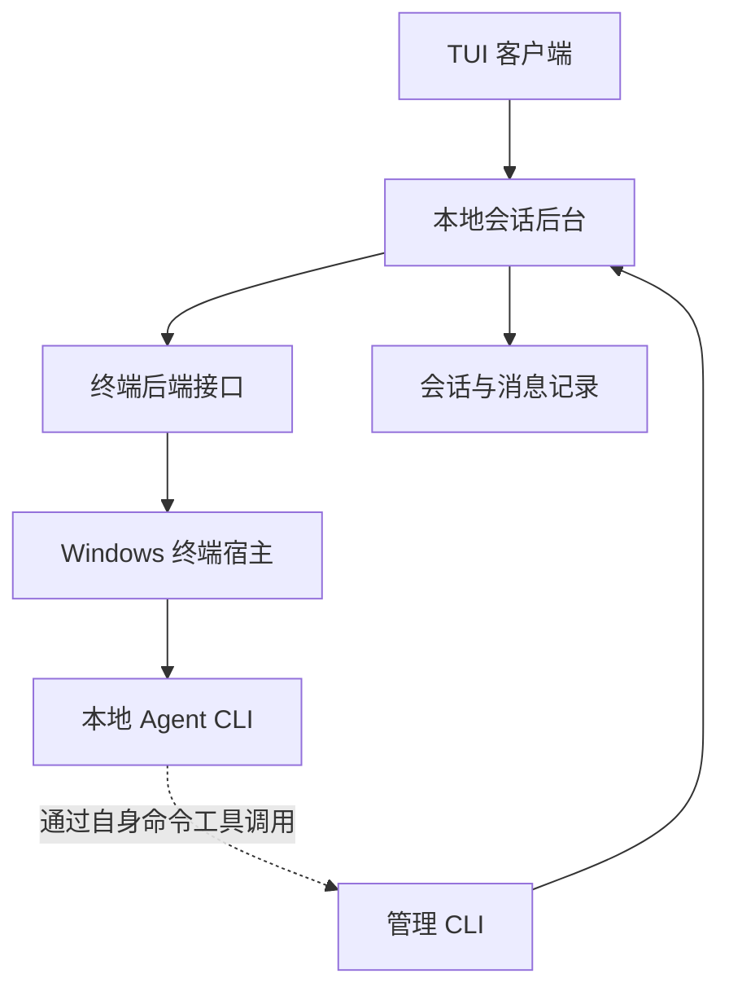

# 架构草案

状态：提议，尚未实现。基线日期：2026-11-20。

本文件定义责任边界与待验证方案，不锁定编程语言、框架、数据库或协议。产品要求见 [PRODUCT_PLAN.md](PRODUCT_PLAN.md)。

## 1. 分层与责任



| 模块 | 职责 |
| --- | --- |
| TUI 客户端 | 会话列表、视图、搜索、交互焦点、终端画面与投递状态 |
| 本地会话后台 | 稳定身份、运行生命周期、终端 I/O、输出记录、消息队列与重新连接 |
| 终端后端接口 | 统一创建、接入、输入、resize、捕获输出、停止与退出事件 |
| Windows 终端宿主 | 候选为 psmux 后台或直接 ConPTY；选型待 M0 验证 |
| Agent 适配器 | 可选的 ready/busy、提交、取消、原生历史与 resume 能力 |
| 管理 CLI | 让用户和具备命令执行工具的 agent 操作已托管会话 |

TUI 的按键处理与绘制不应直接散落 tmux 或 Windows 进程调用。复用上游 UI 时，先识别并抽取这类边界。

## 2. CLI-first 启动描述

用户可以填写一条启动命令。内部应保存明确的可执行入口、参数、工作目录与环境，不把任意字符串直接拼进多层 shell。

以下为拟议配置示例，不是当前可执行的配置规范：

```toml
[agents.local]
name = "Local Agent"
command = "java"
args = ["-jar", "D:/agents/my-agent.jar"]
cwd = "D:/projects/demo"
adapter = "generic-terminal"
```

Windows `.exe`、脚本入口、命令别名、PowerShell 命令和需要 shell 语法的命令要明确区分。复杂管道或脚本可使用显式 shell 启动模式，具体规则由原型验证。

agent 本身必须能在目标环境运行。管理器不自动把 Linux-only 程序转换成 Windows 程序。

## 3. 身份与持久化

- `profile_id`：启动配置身份。
- `session_id`：稳定会话身份，跨重命名、排序和 Run 保持。
- `run_id`：一次启动及进程树的身份。
- `view_id`：界面视图身份，不作为消息寻址依据。
- 消息记录包含 `message_id`、可选 `reply_to`、发送幂等键，以及目标会话和入队时的目标 Run。
- `agent_conversation_id`：可选，由 agent 自身提供，不能用 session_id 冒充。

持久化对象包括配置、会话元数据、运行记录、有限输出记录和消息状态。保存终端记录不会保存 agent 内存或恢复活进程。

输出记录需区分：原始终端字节流、解析后的屏幕/滚动记录、可选结构化对话消息。原始全屏 TUI 重绘日志不能直接当作逐条聊天记录。

## 4. 终端与生命周期

ConPTY 是 Windows 的终端托管机制，宿主需要持续处理输入输出、VT 序列、终端尺寸和相关生命周期。参考 [Microsoft Pseudoconsoles](https://learn.microsoft.com/en-us/windows/console/pseudoconsoles) 与 [创建会话说明](https://learn.microsoft.com/en-us/windows/console/creating-a-pseudoconsole-session)。

需要在 TUI 退出后继续运行时，由独立后台持有终端与通信通道，继续读取输出；不能仅记录 PID。TUI 断开不应触发终端关闭。具体关闭行为见 [ClosePseudoConsole](https://learn.microsoft.com/en-us/windows/console/closepseudoconsole)。

分别实现或声明：

1. 恢复上次界面布局。
2. 接回仍存活的 Run。
3. 启动新的 Run。
4. 通过已验证适配恢复 agent 原生对话。

电脑重启后不能接回原来的活进程。是否续聊和如何处理未完成工作需由 agent 能力与用户操作决定。

## 5. 能力声明与状态来源

建议声明 `terminal_io`、`read_output`、`submit_prompt`、`ready_signal`、`cancel_turn`、`structured_history`、`resume` 等能力。

进程状态与工作状态分别记录：

- 进程：starting / alive / exited / failed。
- 工作：unknown / ready / busy / approval 等，仅在存在依据时使用。
- 状态来源：进程事件、协议事件、hook、人工选择或启发式判断。

“一段时间没有输出”只是一项观察，不能单独证明空闲或完成。对未知 CLI，基础终端读写仍可用，增强能力按实际支持降级。

## 6. 跨会话通信

### 读取

通过 session_id 寻址，返回来源、run_id、输出游标或范围与内容。UI 预览、转交给另一 agent 的内容、模型实际上下文分别处理。默认读取有限范围，避免整段历史无界增长。

### 发送

建议状态包括：queued、input_written、accepted、completed、failed、cancelled、unknown。只有对应证据存在时才更新状态，不要求所有适配器都能到达 accepted 或 completed。

队列保存在管理后台。自动投递要求可靠的 ready 信号；没有此能力的接入可保留待投递消息，并提供明确的输入操作。粘贴与粘贴后提交是不同动作，具体提交方式由配置或适配器定义。

建议规则：消息记录目标 session_id 及入队时的 target_run_id。目标 Run 退出或被替换后，未投递消息暂停并显示原因，不自动进入新 Run 的上下文；入队时没有活跃 Run 的消息也保持待投递，重新指定目标 Run 作为明确操作处理。

同一 session 的用户键盘输入、自动投递和终端协议回复需要有序协调，避免内容交错。中断当前轮次、终止进程、追加提示是不同能力。

### 重试与结果不确定

用消息编号和幂等键防止管理器重复建立同一请求。写入终端后发生断开，可能无法确认 agent 是否执行；此时保留 unknown，不自动重放可能已执行的指令。通用 CLI 路径不承诺端到端 exactly-once。

### Agent 主动调用

下面是拟议命令形状，不代表已实现：

```text
sessionctl list
sessionctl read <session-id> --since <cursor>
sessionctl send <session-id> --file <instruction-file>
sessionctl send <session-id> --reply-to <message-id> --file <result-file>
sessionctl message status <message-id>
```

agent 需要命令执行工具、连接信息和使用说明，才能主动调用。仅向终端写入这些文字，不等于 agent 已经执行工具。可选 MCP 或结构化 agent 协议以后作为其他入口，不改变 CLI 启动约定。

## 7. 工作目录与协作范围

Session 独立不意味着工作文件独立。初版明确显示 cwd，允许选择不同目录；自动 worktree 管理后置。Git worktree 能提供同一仓库的多个工作目录，见 [Git 官方文档](https://git-scm.com/docs/git-worktree)。

跨会话读取范围、默认通信分组、是否允许运行中打断属于产品行为，见 [DECISIONS.md](DECISIONS.md)。初版建议以项目为范围，并由明确的用户操作或已配置的协作规则触发。

## 8. M0 需要回答的问题

- 哪套 UI 的视觉与交互最符合目标，哪些代码可以独立复用？
- psmux 的实际命令和控制能力是否覆盖创建、读取、输入、resize、重连和退出检测？
- 直接使用 ConPTY 时，能复用哪些终端模拟/渲染组件？
- Windows 输入法、宽字符、快捷键、剪贴板与嵌套 TUI 的实际行为如何？
- 后台与客户端的本机通信、记录存储和更新方式如何选择？
- 哪个真实自定义 CLI 用于首个增强适配？

任何候选项目均不视为已经选定的生产依赖。
