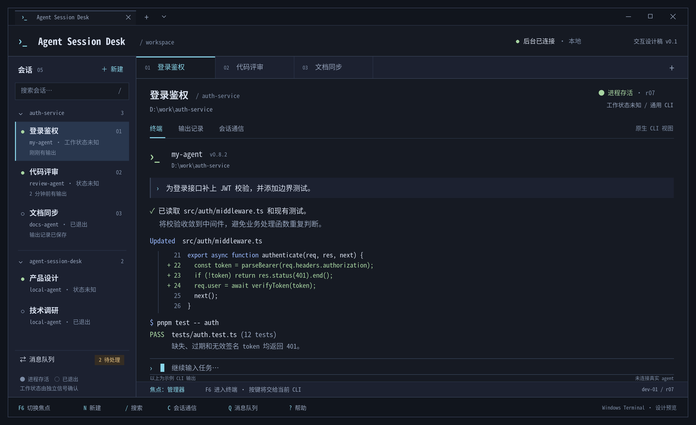
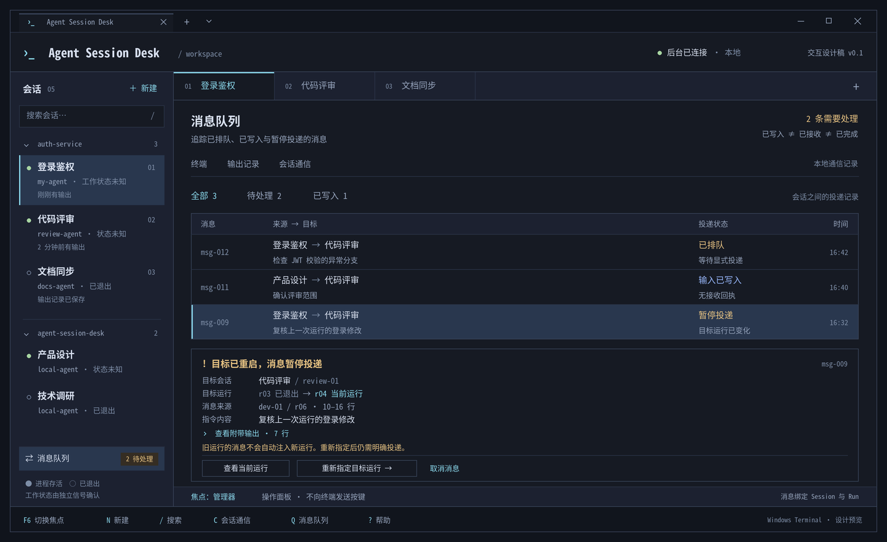

# 界面设计草案

版本：v0.1。日期：2026-11-20。

**状态：待评审，尚未采纳为最终视觉或交互基线，未经 Windows 实机验证。** 本轮设计图和[交互设计稿](design/agent-session-desk.html)用于讨论布局、操作和状态语义，不代表已实现的软件、原生终端兼容性或最终技术选型。示例会话与输出均为演示内容。

本稿落实[产品计划](PRODUCT_PLAN.md)中的核心场景。采用与否及后续调整应另行记入[决策记录](DECISIONS.md)，本文件不自动改变已有决定。

## 文件与使用方式

- **PNG**：四张固定画面的设计图，可直接查看、下载或用于讨论。
- **SVG**：与 PNG 同名的可编辑矢量稿，便于调整文字、颜色和布局。
- **[交互设计稿](design/agent-session-desk.html)**：下载后用浏览器打开。可以切换示例会话、填写新建表单、保存各会话的通信草稿、选择目标、模拟入队与显式投递，以及处理目标运行变化；所有操作只改变页面内的演示数据。
- **[绘图脚本](design/render_vector.py)**：从共享绘图元素导出四组 SVG / PNG，保留可重复生成的设计源。

交互稿中的终端、时间、消息和输出片段均为预置数据。片段范围用于演示，尚未实现真实终端选区、命令执行、后台托管、持久化或跨进程通信。静态图与交互稿表达相同业务状态，分别绘制，不承诺跨浏览器像素一致。

绘图脚本依赖 Pillow 与 Noto Sans CJK 字体，运行 `python docs/design/render_vector.py` 导出。其他环境可通过 `--font-regular`、`--font-bold` 和 `--font-index` 指定字体文件与字形集合；字体变化可能影响排版，导出后需复核。

## 1. 视觉与信息层级

参考 Agent Deck 的会话分组与导航，以及 AoE 对原生输出区域的空间分配。主体采用等宽文字、终端线框、紧凑标题和少量状态色，主要操作有键盘入口。会话名称、当前焦点和待处理事项优先于装饰、汇总数字与扩展配置。

管理器只组织原生 CLI 画面，不把所有程序输出重排成统一聊天气泡。屏幕预览、保存的输出记录和可选结构化对话必须有不同标识。配色同时使用文字和符号表达状态，不能单凭绿点判断完成。

## 2. 四屏工作流程

### 01：多会话主界面

目的：快速找到任务、切换运行实例，并明确当前按键发往何处。

左侧按项目组织会话，提供搜索、名称、状态和待处理提示；右侧尽量保留完整原生 CLI 画面。当前会话显示工作目录，运行身份可在详情查看。底部使用一行焦点与常用操作提示，不长期占用大块正文空间。

切换不会重新启动程序。通用接入可显示“进程存活 · 工作状态未知”；只有适配器提供可信信号时才显示待输入、忙碌等工作状态。已退出会话仍可查看保存记录，但不伪装为活跃终端。

### 02：通过命令新建会话

目的：让使用者像在终端执行命令一样接入自己的 agent。

以紧凑表单填写会话名称、启动命令和工作目录；参数、环境及适配选择放入更多设置。允许直接填写自定义命令，不要求先选择 agent 品牌、模型服务或专用协议。需要 PowerShell 或脚本语法时，明确选择相应启动模式。

主操作是“创建并启动”。命令不存在、目录不可用等错误需对应具体字段。环境信息不在预览中泄露敏感值；尚未验证的历史恢复、自动投递等能力不能在创建时默认显示为已支持。

### 03：跨会话读取并发送

目的：把有来源的工作信息交给明确目标，减少复制时丢失上下文和投错会话。

先选择来源及输出范围，显示只读快照、来源 Session、Run 和游标；再选择目标、填写指令并发送。读取快照只代表管理器展示了内容，不代表当前 agent 已读取，也不会自动注入全部历史。

提交时固定目标及内容，后续切换 Tab 不得改变已提交请求。通用 CLI 状态未知时，默认显示排队或等待显式投递；只有可靠信号支持时才呈现等待就绪的自动投递。“粘贴到输入区”与“粘贴并提交”应是明确不同的动作。

### 04：消息队列与运行变化

目的：让使用者知道消息停在哪一步，以及哪些情况需要自己处理。

列表保留消息编号、来源、目标和状态，选中后查看原文、关联回复及状态依据。目标退出或重启时，显示原目标 Run 与当前 Run 的差异，暂停尚未投递的消息；重新指定目标运行是显式操作，不自动把旧指令交给新上下文。

写入后断开但没有回执时，显示结果未知，不把重试按钮包装成无副作用操作。连接入口区分接回存活 Run、重新启动程序和恢复 agent 原生对话；后者仅在接入能力经过验证后提供。

## 3. 统一身份和状态语义

Session 是稳定工作记录，Run 是一次启动，Tab 是查看入口；重命名、排序和关闭视图不改变会话身份。关闭视图、停止运行、归档记录分别操作。管理器草稿按会话保留，不覆盖子终端自身维护的输入。

| 显示状态 | 允许表达的事实 |
| --- | --- |
| 已排队 `queued` | 管理器已保存待投递请求 |
| 输入已写入 `input_written` | 内容已写入目标通道，尚不能证明 agent 理解 |
| 已接收 `accepted` | 有目标 agent 的明确接收证据 |
| 已完成 `completed` | 有关联请求的完成证据，不等于用户验收通过 |
| 结果未知 `unknown` | 动作结果无法确认，不能自动推定成功或安全重发 |

暂停是投递受阻的说明，例如目标 Run 已变化；不得借暂停状态丢弃原消息和来源。没有增强信号的 CLI 可以一直停留在可证明的阶段。用户打开收件箱只代表看过消息，不代表 agent 接收。

## 4. 焦点与 Windows 验证点

界面持续区分“管理器焦点”和“终端直通”。直通时方向键、Tab、回车及普通输入交给子程序；管理器导航不能同时消费这些按键。**F6 是待验证的焦点切换候选键**，并非已采纳快捷键；需验证冲突、功能键转发和可配置替代入口。

Windows 实机评审至少覆盖：

- 键盘：进入和离开直通模式、复制粘贴、中断、多行提交；终端原生快捷键不被误拦截，失去焦点后不继续发送输入。
- 尺寸：改变终端行列数、字体和缩放后，侧栏与弹窗不重叠，选中项和光标可见；窄窗口有可用退化布局。
- CJK：中文、英文混排、全角标点、宽字符和组合字符不会破坏列对齐、截断和选区定位。
- IME：中文预编辑、候选选择、确认和取消时，文字不重复、不提前提交；输入法切换不触发会话操作。
- 生命周期：退出界面再接回同一 Run；后台断开、agent 退出和 target_run 变化均显示真实状态。

记录 Windows 构建、终端、字体、输入法、shell 和 agent 版本。浏览器设计稿中的输入与缩放效果不能替代上述验证。

## 5. 需求映射与评审门槛

| 画面或规则 | 对应需求 |
| --- | --- |
| 主界面、焦点与草稿 | FR-02、FR-03、FR-04、FR-11 |
| 命令启动表单 | FR-01、FR-02 |
| 来源快照、发送与排队 | FR-06、FR-07、FR-08、FR-09 |
| 队列、回复、异常与重新连接 | FR-05、FR-10、FR-12、FR-13 |

本轮先评审是否便于找到会话、是否看得清正文、输入目标是否明确、消息状态是否可信。四张 PNG 已逐屏检查，未发现内容裁切、缺字或状态语义矛盾；通过静态审查仍不代表设计采纳或 Windows 兼容验收通过。

需求映射表示本轮设计与需求的关联，不表示全部相关交互或能力已经实现。文件已做静态结构与 JavaScript 语法检查；浏览器运行、真实终端行为和 Windows 兼容性仍待验证。

## 6. 上游视觉参考来源

以下来源是上游实际录制的历史界面参考，固定提交保证可追溯，不保证录屏与该提交的当前外观完全相同。录屏中的 agent 专有能力不直接作为本产品通用能力。

- **Agent Deck**：固定提交 [`80494e527393b7ead00da30018e6ee7e60e9d7a0`](https://github.com/asheshgoplani/agent-deck/tree/80494e527393b7ead00da30018e6ee7e60e9d7a0)。参考[原始 overview.webm](https://raw.githubusercontent.com/asheshgoplani/agent-deck/80494e527393b7ead00da30018e6ee7e60e9d7a0/demos/agent-deck-overview.webm)、[搜索录屏](https://raw.githubusercontent.com/asheshgoplani/agent-deck/80494e527393b7ead00da30018e6ee7e60e9d7a0/demos/global-search.gif)及[README 嵌入视频](https://github.com/user-attachments/assets/e4f55917-435c-45ba-92cc-89737d0d1401)。overview 画面显示 v0.5.7，重点借鉴分组导航、预览与命令弹窗。
- **Agent of Empires**：固定提交 [`cfca1cac89a30b32a822342b4a07ce949a73f623`](https://github.com/agent-of-empires/agent-of-empires/tree/cfca1cac89a30b32a822342b4a07ce949a73f623)，参考[README 使用的 TUI demo.gif](https://raw.githubusercontent.com/agent-of-empires/agent-of-empires/cfca1cac89a30b32a822342b4a07ce949a73f623/docs/assets/demo.gif)。重点借鉴宽预览区与紧凑键位提示，不使用 Web 桌面或移动界面作为 TUI 依据。

这里只链接上游素材，不将其当作本项目截图。平台限制、许可证与代码复用边界继续以[参考资料](REFERENCES.md)和后续验证为准。
